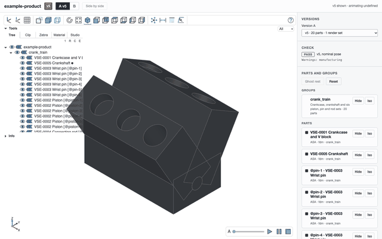
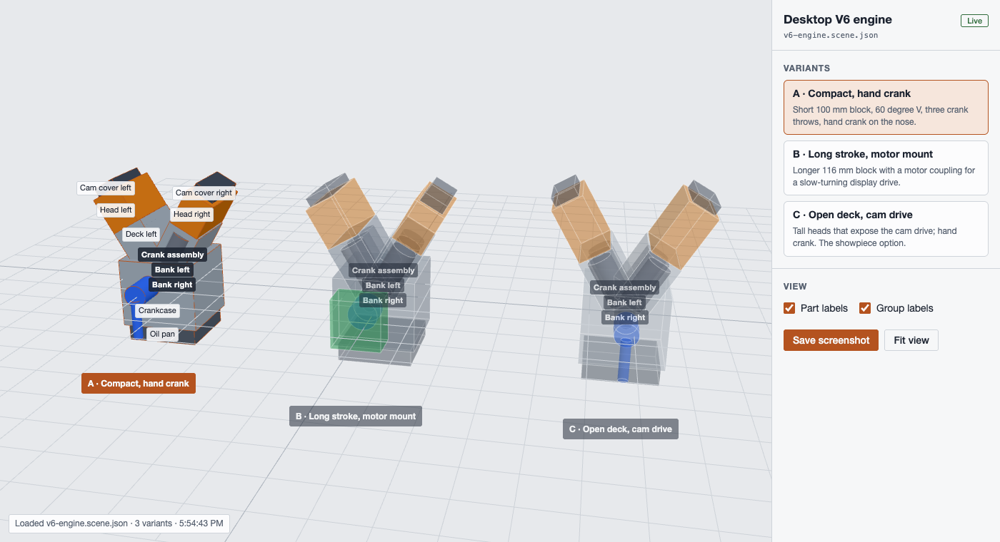
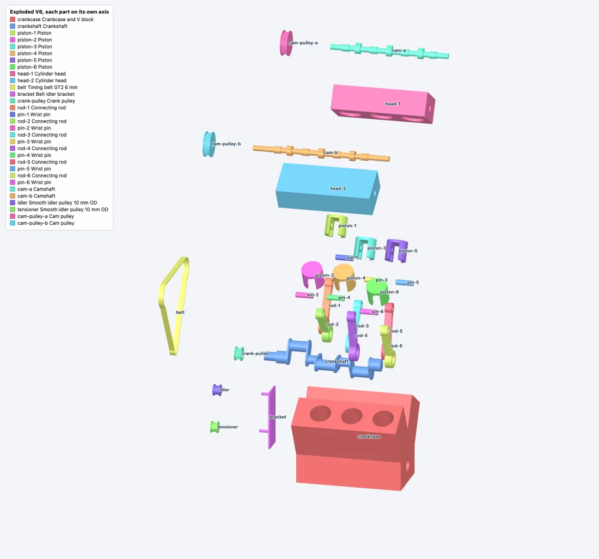
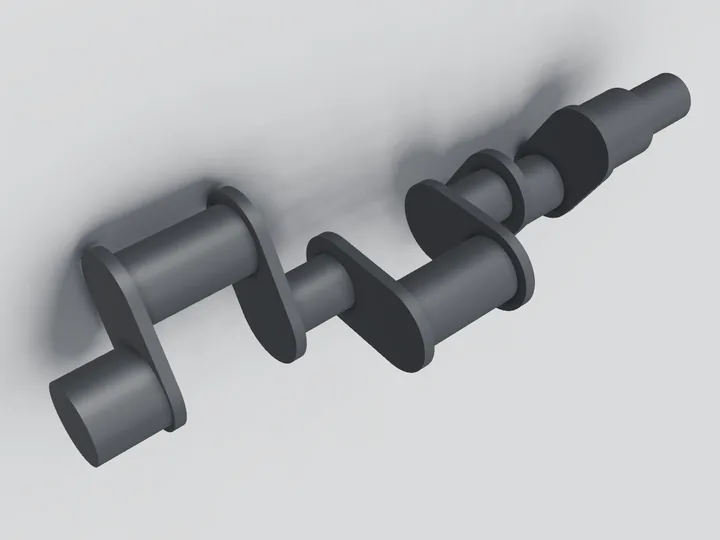
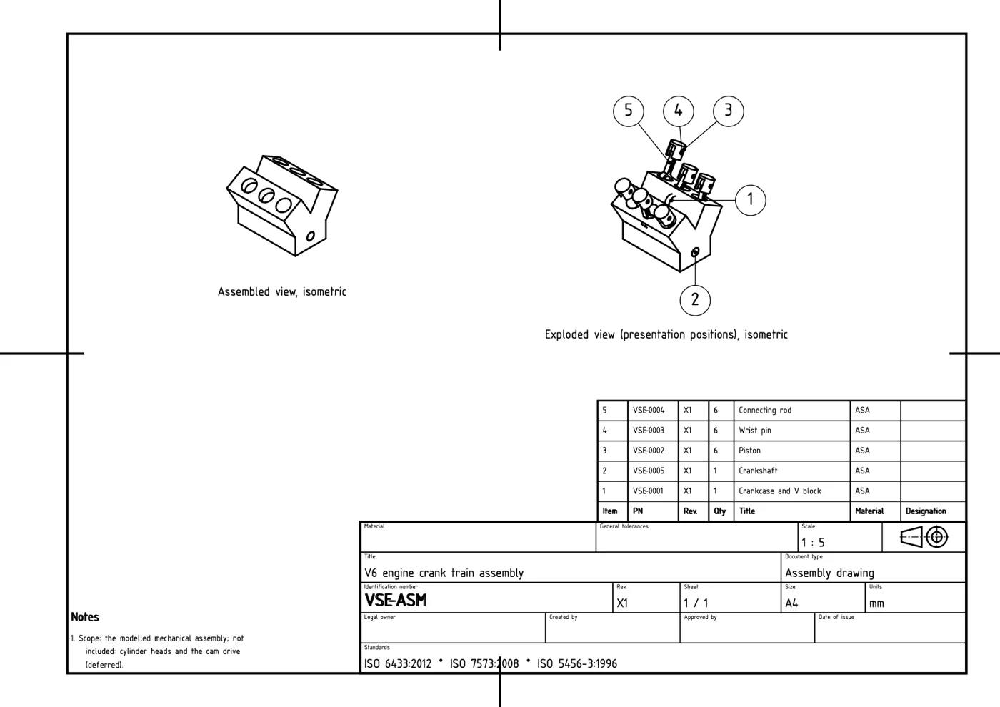
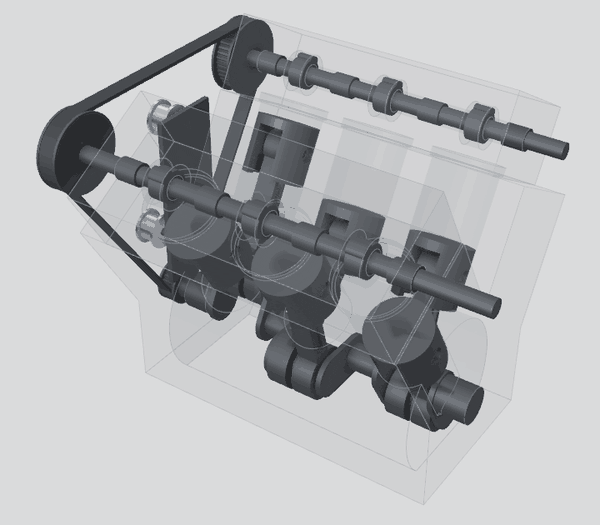
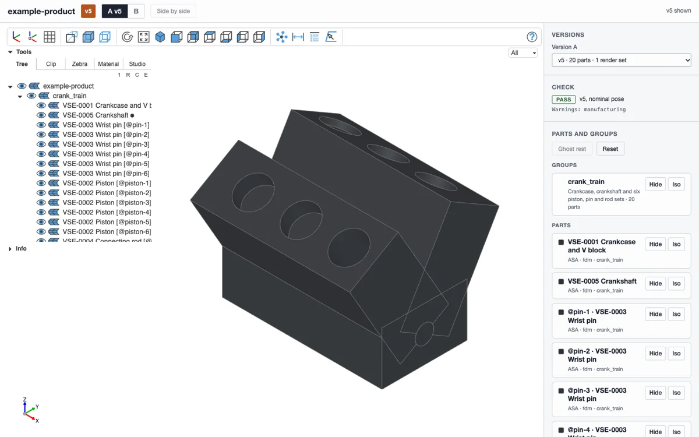

# Benchhand

Agent-assisted mechanical CAD guides a product from concept through versioned CAD. It produces drawings, an engineering bill of materials (EBOM), scoped verification evidence and documentation. It assesses intended service, per-part routes, interfaces and evidenced capability. Missing evidence or coverage stays unknown. An FDM part also gets a 3MF with its geometry, bed orientation and material name. It does not slice, or generate slicer/CAM toolpaths, operate equipment or certify physical performance.

Manufacturing intent is recorded per project and part: a v2 record captures intended use, requirements, candidate selection, material/process routes, real capability, assembly interfaces and evidence. Unknown facts remain unknown. The use-case **service class** describes maturity and consequence. Prototype is a service class. Only record version 2 is read; any other `record_version`, or none, is refused. New freezes/releases require a recorded material/process selection; no selection or other required unknown blocks. See `docs/manufacturing-intent.md`.

This standalone project supports Claude Code, OpenAI Codex CLI, OpenCode, and Kiro CLI through native skills and agent profiles.

## Requirements

- Python 3.12 or later for the host scripts. Code that runs inside `freecadcmd` uses the Python 3.11 that FreeCAD bundles, so it stays compatible with 3.11. `scripts/freecad_job_modules.txt` lists that code.
- [uv](https://docs.astral.sh/uv/).
- FreeCAD 1.1.4 with `freecadcmd` and TechDraw templates. Install the official release from [FreeCAD 1.1.4](https://github.com/FreeCAD/FreeCAD/releases/tag/1.1.4).
  - macOS: use the arm64 or x86_64 DMG. Place FreeCAD.app in `/Applications`.
  - Linux x86_64 or aarch64: download the matching Python 3.11 AppImage and `-SHA256.txt`. Verify the checksum, extract the AppImage, and put `freecadcmd` on `PATH`.
  - See [`cad-drawings/SKILL.md`](skills/cad-drawings/SKILL.md#install-freecad) for commands. If FreeCAD is not on `PATH` or in the macOS app bundle, set `FREECADCMD`.
- Chromium. Preflight and setup install it through Playwright.
- Claude Code, Codex CLI, OpenCode, or Kiro CLI. The installer copies native skills and agent profiles to each harness's project paths. Claude Code also supports plugin marketplace installation.

## Install

Run the installer from the project where you want to use CAD. Set `BENCHHAND` to the repository checkout path:

```sh
BENCHHAND=/path/to/benchhand
python3 "$BENCHHAND/harness/install.py" --harness claude
```

Choose `claude`, `codex`, `opencode`, `kiro`, or `all`. Add `--user` for a user-level install:

```sh
python3 "$BENCHHAND/harness/install.py" --harness all --user
```

Use `--project DIR` to select a project directory. `--dry-run` previews changes, and `--uninstall` removes installed CAD files. `python3 "$BENCHHAND/harness/install.py" --help` lists the options.

Alternatively, install Claude Code as a plugin from this public GitHub repository; `gh auth` is not required for public access. Or use a local checkout:

```text
/plugin marketplace add benchhand/benchhand
/plugin install benchhand@benchhand
```

For a local checkout, add `/plugin marketplace add /path/to/benchhand`. Then install with `/plugin install benchhand@benchhand`. The plugin exposes `/benchhand:cad-flow`. The installer route exposes `/cad-flow`.

In Claude Code, three skills are typable commands: `cad-flow` (the entry point), `cad-viewer` and `cad-fits`. The other twelve `cad-*` skills carry `user-invocable: false`, so the `/` menu omits them in both the installer route and the plugin route, but the model still loads them when a stage needs one. `user-invocable` is a Claude Code extension, not an Agent Skills key, so a strict Agent Skills validator rejects those twelve shared `SKILL.md` files. This is an accepted exception: the plugin route reads `skills/` directly and has no other place to carry the key. `install.py` strips the key for every harness except Claude, so Codex, OpenCode and Kiro get spec-only skills. `harness/test_skill_visibility.py` fails when a skill is not classified as visible or hidden.

## Start and prepare a project

In an interactive Claude Code or OpenCode chat, start with `/cad-flow`. For interactive Kiro, use `/cad-flow` in a V3 session (`kiro-cli chat --v3`). In Codex CLI, invoke the skill with `$cad-flow` or select it from `/skills`. Describe the product or ask to continue the existing design record. For example: `Take this desk lamp arm from concept through a verified CAD release.`

At the project root, set `$CAD_SKILLS` to the directory containing installed `cad-*` skill folders. For a project install, this is `.claude/skills`, `.agents/skills`, `.opencode/skills`, or `.kiro/skills` for the selected harness. If using a repository checkout directly, set it to `"$BENCHHAND/skills"`.

### Codex CLI sandbox requirements

When using `workspace-write`, command network access is off by default. If you enable a local network proxy, Codex also blocks loopback and private destinations unless you allow them. In the E2E run, this sandbox could not bind the `cad-concept` and `cad-viewer` loopback servers. It could not start Chromium for `cad-render` or launch FreeCAD/Qt for drawings. In a trusted project, run these tools with `codex exec --sandbox danger-full-access` or use the `:danger-full-access` permission profile. Both remove local sandbox restrictions. Do not use them on untrusted projects. [Codex sandbox and approvals](https://learn.chatgpt.com/docs/agent-approvals-security) · [Codex permissions](https://learn.chatgpt.com/docs/permissions)

| Tool | Host capability needed |
|---|---|
| `cad-concept` and `cad-viewer` | Permission to create loopback listeners. |
| `cad-render` | Permission to launch the Chromium/Playwright browser process. |
| `cad-drawings` | Permission to launch FreeCAD and its Qt process. The E2E host also reported a Qt/NEON startup error. Disabling the sandbox cannot fix an unsupported or broken host runtime. |

Codex custom agents inherit their parent's sandbox. A narrower profile can grant command network access and explicitly allow loopback/private targets. Codex docs do not promise that a profile alone permits local server binding or these GUI subprocesses. Configure process approval as needed. Verify the exact host/runtime. Otherwise, use full access only in a trusted project. [Codex sandbox and approvals](https://learn.chatgpt.com/docs/agent-approvals-security) · [Codex permissions](https://learn.chatgpt.com/docs/permissions)

### Claude Code non-interactive runs

If a Claude Code `-p` run has a turn limit, set `--max-turns` above the number of turns needed for the whole stage. Claude Code errors when it reaches that limit. If the stage presents a gate, capture the session ID. Resume that conversation with `claude --resume <session-id> -p "<your explicit gate decision>"`. [Claude CLI reference](https://code.claude.com/docs/en/cli-reference) · [Claude headless mode](https://code.claude.com/docs/en/headless)

### Kiro CLI entry points

For `--no-interactive` runs, do not type a bare `/cad-flow`. Kiro parses it as an unknown CLI subcommand. Instead, ask for the `cad-flow` skill in a prose prompt. For example: `kiro-cli chat --v3 --no-interactive "Use the cad-flow skill to continue the design record."` Headless Kiro takes a positional instruction or stdin. [Kiro headless mode](https://kiro.dev/docs/cli/headless/)

Generated Kiro custom-agent profiles use the current V3 schema. Run a working V3 engine with `--v3`; `--agent-engine v1` cannot load these profiles. Kiro documents separate older CLI 2.x profile fields (`allowedTools` and `toolsSettings`) and a migration path, but this project does not generate duplicate legacy profiles. In the E2E, the missing optional KiroCrew `config/prompt.md` prompt URI produced a non-fatal warning; the default v2 and v3 smoke tests loaded the profiles. Do not treat that warning alone as a startup failure. [Kiro V3 agent configuration](https://kiro.dev/docs/cli/v3/agent-config/) · [Kiro profile migration](https://kiro.dev/docs/cli/v3/upgrade-agent/) · [Kiro CLI V3](https://kiro.dev/docs/cli/v3/)

Shell-capable worker profiles intentionally allow only the documented `uv run --script` commands. Use the harness read/search tools to inspect project files. Do not use shell commands for file inspection.

Run preflight to see missing prerequisites:

```sh
uv run --script "$CAD_SKILLS/cad-flow/scripts/preflight.py"
```

Setup plans environment creation and user-level actions. Add `--yes` to run those actions. Setup warms the CAD kernels, Chromium, and the pinned three.js cache:

```sh
uv run --script "$CAD_SKILLS/cad-flow/scripts/setup.py"
uv run --script "$CAD_SKILLS/cad-flow/scripts/setup.py" --yes
```

The direct `uv run --script` form is valid for `setup.py`; the shared launcher below also handles uv's reserved script basenames.

Setup checks FreeCAD 1.1.4 first. It stops if FreeCAD is absent or the version is wrong. Run preflight again after setup. Use `uv run --script "$CAD_SKILLS/cad-flow/scripts/preflight.py" --warm` to install or check Chromium and warm the render cache.

### Skill script launcher

Use the shared launcher for scripts that need the shared CAD environment:

```sh
uv run --script "$CAD_SKILLS/cad-flow/scripts/run.py" <skill>/scripts/<script>.py [args...]
```

The shared launcher reads inline dependencies and uses an environment keyed by dependency set. For `setup.py`, `pyproject.toml`, or `setup.cfg`, it uses `--with` instead of the reserved `--with-requirements` input form.

The target path is relative to `$CAD_SKILLS`, such as `cad-model/scripts/cad_model.py`. Resolve each skill's scripts, assets, and documents relative to that skill folder. Run lightweight standalone scripts directly with `uv run --script`.

### Output modes

These producers print either full JSON or a short summary:

- `cad_model.py`
- `form_check.py`
- `render.py`
- `motion.py`
- `validate.py`

The summary holds the verdict, up to five blocking findings and the path of the full JSON. That file sits under `.cad-work/agent-output/`, or is the `--out` file. A result shorter than its summary prints whole.

The mode comes from the first of these that applies:

1. The `--json` flag: full JSON.
2. The `CAD_OUTPUT` variable: `compact`, `json`, or `text`. `text` renders as `compact`.
3. The stream: `compact` on a terminal, `json` when piped or redirected.

`run.py` sets `CAD_OUTPUT=compact` unless you already set the variable. A script that parses a producer's stdout must pass `--json` or set `CAD_OUTPUT=json`.

Full JSON is a tool-result envelope with four keys:

- `schema`: the envelope id, `tool-result/1`.
- `status`: the verdict, such as `pass`, `fail` or `error`.
- `findings`: the findings of the result.
- `payload`: the producer's result, unchanged.

The envelope wraps stdout and the `--out` files that are not sealed, such as `cad_model.py check --out`. These files keep their own shape:

- sealed bundle and version files
- the check packet that `form_check.py --out` writes

Read a stdout document with `unwrap()` from `cad-record/scripts/emit.py`.

## Workflow

The `cad-flow` skill guides these stages:

1. GROUND, INTENT, and SPECIFY
2. L0 CONCEPT and the VARIANT gate
3. L1 LAYOUT and LAYOUT freeze
4. L2 PARTS and the PARTS gate, L3 DETAIL and the DETAIL gate, and BOM
5. L4 ANALYSIS and the ANALYSIS gate, CRITIQUE, RECONCILE, and DESIGN freeze
6. RELEASE gate and RELEASE

GROUND captures product use and operating conditions. The lead records requirements, preferences, assumptions and open questions separately. INTENT compares complete part-level architecture/material/process routes against mandatory criteria. Mandatory failures are eliminated before preference ranking. Unknowns stay conditional.

Do not assume a printer, material, process, capability, tolerance or service requirement. Optical requirements exclude opaque processes. Use traceably identified purchased transparent parts or identified transparent stock on an appropriate evidenced route. Do not suggest see-through FDM or unidentified clear plastic. SPECIFY records per-part intent, separate capability profiles, functional interfaces, assembly access and evidence obligations. See the [manufacturing-intent guide](docs/manufacturing-intent.md).

The lead maintains the `hw/` record and integrates stage work. The lead builds immutable L1-L4 versions and runs established checks in fail-fast order. Gate ownership and sequence remain with `cad-flow`.

PARTS and DETAIL checks dispatch by declared process, operation, material and capability. The [process-check reference](skills/cad-design/references/process-checks.md) lists obligations. Geometric/form and build-envelope heuristics are diagnostics, not process or physical proof. The [fit/access reference](skills/cad-fits/references/process-fits.md) describes worst-case stacks and qualified RSS. Distinguish CAD validity, geometric eligibility, process planning, simulation support and physical evidence. A preview, nominal model, envelope fit, solver result, planned coupon or agent verdict does not prove physical performance. Changes to service, load, material/condition, route/capability, orientation/support/finish, geometry, interfaces or criteria can stale dependent evidence. Recheck from the earliest affected stage. The detailed [walkthrough](docs/walkthrough.md) describes prompts, reviews, approvals and records.

The lead records user-approved gates as dated decisions in `hw/decisions/` and keeps the current stage in `hw/product.yaml` `flow`. LAYOUT freeze, PARTS, DETAIL and ANALYSIS each pass two gates. INTENT, VARIANT, DESIGN freeze and RELEASE are single human gates. Only explicit user approval closes a human gate. Failed checks, major scoped review findings or user-identified changes reopen dependent stages. Provisional decisions enable work but approve, freeze or release nothing. The workflow has no ledger.

Agents keep worker scratch and temporary files under `.cad-work/` beside `hw/`. Harness policy is not an operating-system security boundary. Enforcement varies across harnesses and file-writing surfaces. Use an OS sandbox or container for a hard write boundary.

## Tests

Run each skill test file separately with the test pins in `harness/test-requirements.txt`. The harness and script tests use `harness/test-requirements-min.txt` (PyYAML only), so a host script that imports a package it never declares still fails. The FreeCAD Python 3.11 import check uses `harness/test-requirements-freecad.txt`:

```sh
for test in skills/*/test_*.py skills/*/tests/test_*.py; do
  [ -f "$test" ] || continue
  uv run --no-project --with-requirements harness/test-requirements.txt \
    python -B -m unittest discover -s "$(dirname "$test")" -p "$(basename "$test")"
done
uv run --no-project --with-requirements harness/test-requirements-min.txt python -B -m unittest discover -s harness -p 'test_*.py'
python3 harness/generate.py --check
uv run --no-project --locked --script scripts/typecheck.py
uvx slopvac <changed-prose-files>
```

The mypy command is development-only. Its PEP 723 lock pins the current verified stable version. `mypy.ini` enumerates all feature-changed/new production modules using an incremental baseline and makes the new pure contracts/handlers strict; type findings are reported in `cad-mfg-intent/U8F-notes.md`. Tests that use FreeCAD skip when FreeCAD 1.1.4 is unavailable. Set `CAD_REQUIRE_FREECAD=1` to make them fail instead, as CI does. Check changed Markdown with `uvx slopvac`.

## Skills and agents

| Skill | Responsibility |
|---|---|
| `cad-flow` | Stage sequence, gates, and project workflow |
| `cad-record` | Structured design record, validation, evidence and release |
| `cad-concept` | Rapid concept variants and previews |
| `cad-model` | CadQuery/build123d model builds and geometry checks |
| `cad-design` | F0-F3 appearance fidelity and manufacturing dispatch guidance |
| `cad-motion` | Assembly poses, motion sweeps with between-sample proofs and subsystem runs, and motion renders |
| `cad-render` | Versioned PBR renders |
| `cad-viewer` | Interactive OCP inspection and Studio look-dev |
| `cad-analysis` | Sourced static finite-element analysis |
| `cad-bom` | EBOM roll-up |
| `cad-drawings` | Part and assembly engineering drawings |
| `cad-fits` | Fits, worst-case stacks and justified statistical analysis |
| `cad-recheck` | Changed-part and dependent rechecks |
| `cad-review-dfm` | Evidence-based declared-route and capability-gap critique |
| `cad-review-mech` | Evidence-based mechanical premise review |

Harness-native agent profiles support concept design, part design, sourcing research, analysis, mechanical and DFM review, and mechanical clerical work (`cad-clerk`). The harness installer and generator use Python's standard library.

### Agent model tiers

An agent source may set `tier: cheap|standard|strong`. Only `cad-clerk` is on the cheap tier. It handles mechanical chores and never issues a verdict, approval or gate decision. `generate.py` rejects `tier: cheap` for any agent outside its `CHEAP_ELIGIBLE` allowlist. Reviewers, analysts and verdict issuers therefore stay off the cheap tier.

The generated profiles name no model. Supply models at install time, repeating `--tier-model` as needed:

```sh
python3 "$BENCHHAND/harness/install.py" --harness all --project . \
  --tier-model claude:cheap=haiku --tier-model codex:cheap=<model> \
  --tier-model kiro:cheap=<model> --tier-model opencode:cheap=provider/model#variant
```

A bare `TIER=MODEL` covers Claude, Codex and Kiro. OpenCode needs the `opencode:` prefix and a `provider/model[#variant]` value, and never gets `model: inherit`. Rendering adds `model: "<m>"` to Claude (instead of `inherit`) and OpenCode, `model = "<m>"` to Codex, and `"model"` to Kiro. A tier with no entry adds no model line, so a default install matches the committed profiles. `--tier-model` needs PyYAML.

<!-- slopvac-allow: rule=prose-promotion.promotional-verbs reason=domain-term -->
## Showcase

[`examples/v6-engine`](examples/v6-engine/README.md) takes a 3D-printable desktop V6 engine through the flow, from the project-start questions to a release attempt. The scope is small: one rod, one piston and one pin, each placed six times on a 60° V. The example leaves out the heads and the cam drive. Its record lives in `examples/v6-engine/hw`, and every number below comes from real tool output.


Beats: [1 Ground](#1-ground) · [2 Intent](#2-intent) · [3 Specify](#3-specify) · [4 Concept](#4-concept) · [5 Layout](#5-layout) · [6 Parts](#6-parts) · [7 Detail](#7-detail) · [8 BOM](#8-bom) · [9 Analysis](#9-analysis) · [10 Critique](#10-critique) · [11 Release](#11-release)

The viewer steps the crank through the default motion plan and lists the parts and the check result beside the model:



### 1. Ground

The use case stays `unknown` where nobody has answered. These fields each point at an open question (Q-001 to Q-011) instead of a guess:

- service class
- loads
- environment and life

```yaml
use_case:
  status: unknown
  service_class: {status: unknown, reason: not recorded yet, question: Q-001}
```

### 2. Intent

The user confirmed two decisions on 2026-11-23. DR-001 records the project-start answers in `flow.profile`: FEA on, stack-up on, critique full, results out of git. DR-002 prints every custom part in ASA on a Bambu H2D class printer. It names no filament grade, so the material profile holds no sourced properties.

### 3. Specify

Six requirements each carry a verification method. REQ-001 asks the crank to turn through 720° with all six pistons moving and no pair touching. The wrist pin and the bearing seats take ISO 286 fits from `fits.py`. The 6 H7/g6 pin fit gives 4 to 24 µm clearance, and the 14 H7/f7 seat gives 16 to 52 µm. That is partial evidence for REQ-003, which also asks for a running clearance on every moving pair. No criterion exists for those pairs, so `verification.csv` reads `not_assessed`.

### 4. Concept

Three three.js variants, compared against the requirements before any CAD.



### 5. Layout

The first build places one definition of each part six times. One crank drives them through a slider-crank coupling in `assembly.yaml`. The commit-time check on v4 found a real overlap:

```text
piston-1 / rod-1   clearance 0.000 mm   interference 99.12 mm3   ok: false
```

The record keeps the excerpt for all six pairs in [`v4-commit-check-interference.json`](examples/v6-engine/hw/manufacturing/sources/showcase-evidence/v4-commit-check-interference.json). The rod's small end (radius 6 mm) was wider than the piston slot. The 720° sweep skips pairs that a joint connects, so only the commit check saw the overlap. The example README tracks this gap as benchhand-c7q.10. Version v5 widened the slot.



### 6. Parts

The F2 form check tests the FDM wall rule against the 1.2 mm guideline. On v3 it measured 1.001 mm at the crankcase window and 0.994 mm in the piston, and both failed ([excerpt](examples/v6-engine/hw/manufacturing/sources/showcase-evidence/v3-form-check-walls.json)). Version v4 passes both. The remaining findings are unknown obligations (orientation, supports, warp), not failures.



### 7. Detail

The stack of the piston in its bore gives 0.30 to 0.65 mm against a 0.2 mm minimum. Still, `stackup.py` refuses to call the requirement met, because the limits are estimates with no calibrated printer behind them:

```text
stackup: requirement not established (worst_case)
```

The assembly drawing sheet (VSE-ASM) lists the five items with their quantities and shows the exploded pistons.



### 8. BOM

`bom.py` reconciles the roll-up against the v4 snapshot: five rows, 20 instances, no mismatches.

| PN | Title | Qty |
|---|---|---|
| VSE-0001 | Crankcase and V block | 1 |
| VSE-0005 | Crankshaft | 1 |
| VSE-0002 | Piston | 6 |
| VSE-0004 | Connecting rod | 6 |
| VSE-0003 | Wrist pin | 6 |

### 9. Analysis

The first 720° sweep on v1 found six collisions between the crankshaft and the rods ([excerpt](examples/v6-engine/hw/manufacturing/sources/showcase-evidence/v1-sweep-collisions.json)). The central journal (radius 7 mm) ran through every rod big end. Version v2 replaced it with two link shafts between the throws. The next sweep over 145 poses found 0 collisions and a smallest gap of 0.052 mm. That is partial evidence only. The sweep excludes the 19 pairs that a joint connects, enforces no pair minima, and leaves the between-sample check incomplete. REQ-001 therefore reads `not_assessed` in `verification.csv`. The example README tracks this gap as benchhand-c7q.10.



An exploratory static FEA of one rod gives a peak of 4.51 MPa. It assumes 100 N, an ASA yield of 40 MPa and one mesh. No retained solver bundle backs it, so REQ-004 reads `not_assessed` in `verification.csv`.

### 10. Critique

An independent read-only reviewer (session ses_df60a1580ffe9NEcW4amRF9JX5) ran the DFM and mechanical reviews at commit eb102786. Both returned MAJOR. DR-003 and DR-004 record them with status `proposed`:

```text
DFM-01 support_unplanned           major  UNKNOWN  REQ-005
MECH-01 clearance.nominal_contact  major  FAIL     REQ-003
MECH-04 stack.estimated_limits     major  UNKNOWN  REQ-001/003
```

MECH-01 was a real fail: the crank web faces sat on the block window walls, 0.000 mm apart. The window is now 2 mm wider on each side. The unknown findings stay open obligations. They need prints, gauging or the user's decision, and no disposition turns them into a pass.



### 11. Release

The release is blocked, and the dry run shows why. `release.py hw --rev A --version v7 --decision DR-004` refuses with 21 findings ([excerpt](examples/v6-engine/hw/manufacturing/sources/showcase-evidence/v7-release-dry-run.json)). Four of them. Five more `release.changed` findings name the evidence excerpts themselves, which were added after v7 was built:

```text
release.decision  DR-004 has status proposed, not the user's approval (accepted)
release.frozen    product.yaml has no flow.frozen; freeze a version first
release.failed    VSE-0001 manufacturing is not a complete pass   (x5)
release.missing   analysis case piston-bore has no result for v7
```

The human gates, the print orientations and the gauged fits wait for the user. `validate.py` passes on the record, and no release package is sealed.

## License

Benchhand uses the [Mozilla Public License 2.0](LICENSE). Two files stay under the
[Apache License 2.0](LICENSES/Apache-2.0.txt) because they derive from
[AgentCAD](https://github.com/jdilla1277/agentcad):

- `skills/cad-model/scripts/cadmodel/safe.py`
- `skills/cad-model/scripts/cadmodel/occ_derived.py`

The project follows the [REUSE](https://reuse.software) specification: each file's SPDX header, or
`REUSE.toml` for files that cannot carry one, names its copyright holder and license. Check them with
`uvx --from 'reuse[charset-normalizer]==6.3.0' reuse lint`. [NOTICE](NOTICE) records third-party
attributions, including the font notices.
